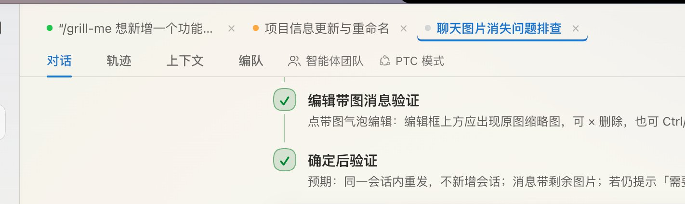
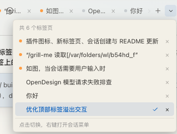
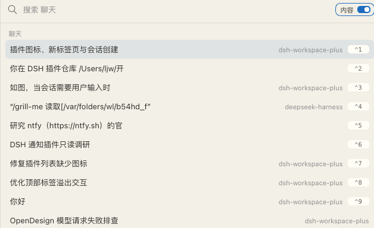
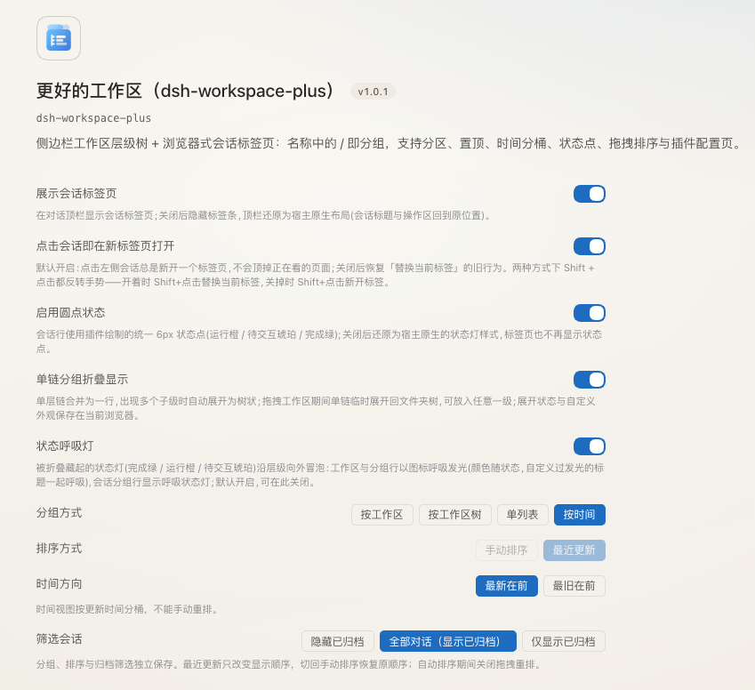
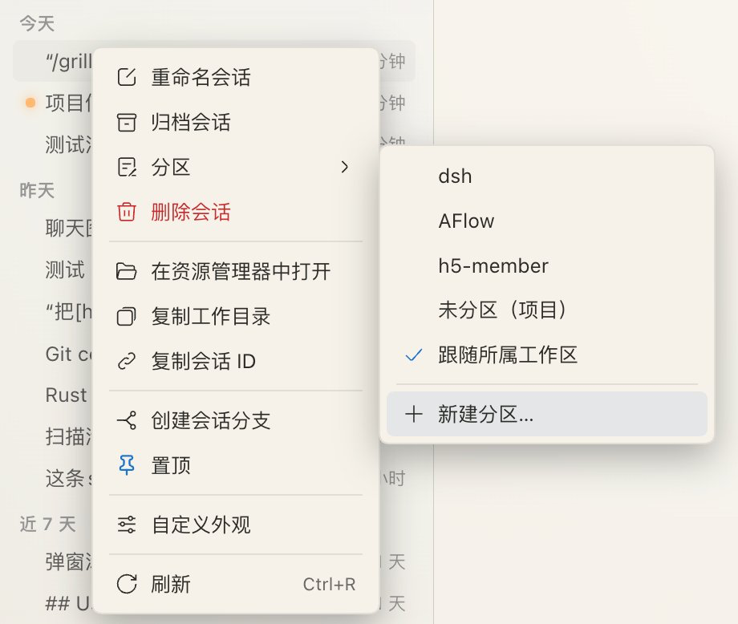

<div align="center">

# dsh-workspace-plus

**给 DSH 的侧边栏装上「文件夹系统」与浏览器式会话标签页，外加统一状态点与插件配置页**

[](https://github.com/lsdt45/dsh-workspace-plus/releases)
[](https://github.com/lsdt45/dsh-workspace-plus/releases)
[](https://github.com/lsdt45/dsh-workspace-plus)
[](LICENSE)
[](https://awesome-dsh-plugin.com)

[简体中文](README.md) · [English](README_EN.md)

</div>

---

DSH 插件：给 [DeepSeek Harness (DSH)](https://www.npmjs.com/package/@deepseek-ai/dsh) 的侧边栏「工作区」列表装上一套**文件夹系统**——工作区还是那个工作区（一个目录），但标题里的 `/` 就是层级，让「网页前端」「网页后端」这类工作区归到同一个 `web` 分组下；再叠加浏览器风格的**会话标签页**、统一**状态点**与**插件配置页**。

- 🗂️ **层级树** —— 工作区 / 会话标题里的 `/` 即分组，任意多级；另含分区、置顶、时间分桶与拖拽排序
- 📑 **会话标签页** —— 点击会话即开新标签（Shift+点击改为替换当前标签，可在设置里把两种手势对调）、行末 `+` 一键新会话、右键复用会话菜单、拖拽实时排序；标签过多时先压缩、再滚动，并以「全部标签页」列表兜底；顺序随重启恢复，最多 12 个
- 🔍 **全文检索** —— 窗口正中的浮层搜索：标题即时匹配 + 会话正文检索（插件自带容错索引，坏日志逐条跳过）；「内容」开关、⌃1–9 直达。**首次内容检索会在后台建索引，需几十秒，期间标题检索照常可用**
- 🔴 **状态点** —— 每行统一 6px：运行橙呼吸 / 待交互琥珀 / 完成绿，标签条同步显示
- 🎛️ **插件配置页** —— 「展示会话标签页」「启用圆点状态」等开关，关掉即还原宿主原生顶栏与状态灯
- 📦 **装上就能用** —— 预构建产物随仓库与 Release 提供，从 git 安装无需构建

> **更新提示**：`dsh plugin --profile desktop update @lsdt45-dal/dsh-workspace-plus`（Web 端把 `desktop` 换成 `web`），更新后重启 DSH 生效；标签页与状态点都可在「设置 → 插件 → 更好的工作区」里逐项开关。

> Fork of [KannaKuron/dsh-better-workspace](https://github.com/KannaKuron/dsh-better-workspace)

**目录**：[功能与效果](#功能与效果) · [安装](#安装) · [工作原理](#工作原理) · [开发](#开发) · [更新日志](https://github.com/lsdt45/dsh-workspace-plus/releases) · [License](#license)

<details>
<summary><b>功能小节索引</b></summary>

- [层级树](#层级树)
- [添加工作区：点选分区与分组](#添加工作区点选分区与分组)
- [分组增删](#分组增删)
- [会话标签页](#会话标签页)
- [搜索](#搜索)
- [工作区与会话分区](#工作区与会话分区)
- [视图配置](#视图配置)
- [插件配置页](#插件配置页)
- [会话置顶](#会话置顶)
- [状态一目了然](#状态一目了然)
- [外观自定义](#外观自定义)
- [单链折叠](#单链折叠)
- [拖拽](#拖拽)
- [右键菜单](#右键菜单)
- [不丢原生能力](#不丢原生能力)

</details>

```
github/                 ← 虚拟分组（不是真实目录，纯命名层级）
└─ dsh-plan-plus        ← 工作区「github/dsh-plan-plus」
dsh-workspace-plus      ← 原有的单层工作区照常工作
codeisland-ask-bridge
dsh-model-config
```

## 功能与效果

### 层级树

<table>
<tr>
<td align="center" width="48%"></td>
<td valign="top"><b>层级树（项目视图）</b><br/>工作区名称里的 <code>/</code> 即分组：如 <code>github/dsh-plan-plus</code> 自动归入 <code>github</code> 虚拟分组，支持任意多级；单层工作区（如 <code>dsh-workspace-plus</code>）照常显示在根层。重命名工作区后树<b>即时重排</b>——分组只是名字的投影，没有第二份需要同步的数据。</td>
</tr>
</table>

### 添加工作区：点选分区与分组

点「添加工作区」并选完文件夹后，弹出一个小对话框，两个目标字段都可**直接点选**,不再是只能打字的原生 datalist:

- **所属分区**：点开就是分区列表，单击即选中（含「不分区（项目）」）；也可以就地「新建分区…」输入名称，回车或「确定」后随工作区一起创建——取消弹窗不会留下空分区。
- **所属分组**：自由输入名称路径（如 `web`），下拉里列出已有层级并可单击选中，也支持「新建分组「…」」与「不嵌套（根级）」。

两处控件外形一致（方框右内侧同一个箭头），下拉都是浮层：展开/收起时**弹窗高度不变**,也不会被弹窗圆角裁切；最后一个「所属分组」的下拉在空间不足时自动向上展开，因此底部按钮始终可见。列表展开时按 Esc 只收起列表，不会关闭整个弹窗；支持单击选择与 ↑/↓/Home/End 走查。对话框底部实时预览最终标题（如 `web/frontend/新项目`）以及是否并入某个分区。确认后插件创建工作区、写入分组前缀并使它立即出现在所选分区下。对话空态页的「添加工作区」走的也是这条交互。

### 分组增删

右键任意分组行即可：**新增子分组**（路径自动带上父分组前缀）、**新增子工作区**（选完目录后所属分组输入框自动预填）、重命名分组、删除空分组；标题栏不放独立按钮。空分组持久保存在浏览器本地；一旦有工作区落进去，分组就由名称自然派生。

### 会话标签页

<p align="center"></p>

打开的会话一个占一个标签，排在对话顶栏、视图切换行上方：每个标签自带**状态点**、标题和关闭按钮，当前标签用**品牌色下划线 + 加粗标题**强调。行末还有一个 `+` 用于新建会话。

- **打开方式**：点击左侧会话 = **在新标签页打开**（不会顶掉正在看的页面）；**Shift + 点击** = 替换当前标签里的会话。两者可在「设置 → 插件 → 更好的工作区 → 点击会话即在新标签页打开」里对调：关掉开关后普通点击恢复「替换当前标签」，Shift+点击则改开新标签。**新建会话**（标签条行末的 `+`、工作区行的 `+` 按钮、快捷键，或任何宿主入口）自动开一个新标签——标签条上的 `+` 调用的就是宿主自己的「新会话」入口，工作区由宿主按「当前工作区 → 最近工作区」挑，和快捷键完全一致——未发消息时标签显示「新会话」，发出第一条消息后变成正式标题。标签槽位于顶栏左侧的公开插槽；标签条宽度按顶栏实际可用空间测量（52vw 只是首次测量前的兜底），不会挤占右上角的宿主控件。
- **悬停看详情**：鼠标停在标签上会弹出一个气泡（位置在标签下方），显示**完整标题**和「所属项目 · 更新时间」，和左侧会话行悬停时的气泡同一套样式，长标题被截断也能看全。
- **标签宽度自适应**：每个标签按自己的标题**自适应宽度**（短标题短、长标题长，上限 200px，下限 72px），不再被拉伸成等宽；标签条整体以「右侧操作区之前 12px」为上限，标题长、标签多时先压缩到下限再横向滚动，始终不会挤压右上角的宿主控件。
- **标签过多时（溢出处理）**：标签先按浏览器习惯**自动压缩**到可读宽度；仍放不下时标签条变成可横向滚动——滚轮/触控板横滑直接滚动标签条，两端出现**渐隐**提示还有标签，末尾出现 **▾「全部标签页」** 按钮。点开即列出全部标签（含被滚出可见区的）：状态点、当前项勾选、悬停逐个关闭，右键仍是同一套会话菜单；↑/↓ + Enter 键盘切换，Esc 关闭。切换标签（含从列表里选择）时当前标签会自动**滚回可见**，不会再出现「最后一个标签被切掉、又翻不到」的情况。
- **右键菜单**：在标签上右键，弹出与左侧会话行**完全相同**的菜单（重命名 / 归档 / 分区 / 置顶 / 分支 / 删除 / 自定义外观 / 刷新…，内容见下文「右键菜单」），因为它复用同一套菜单状态，不是另做一份。
- **拖拽排序**：按住标签左右拖动即可**实时换位**（HTML5 拖拽；拖动中的标签半透明，其余标签即时让位，松手即落位）。
- **持久化与上限**：标签顺序与打开的标签列表保存在当前浏览器（`dsh.betterWorkspace.tabs.v1`），刷新/重启后恢复；最多 12 个，超出时最旧的标签自动退出。
- **自动清理**：关闭当前标签时相邻标签接管；被放弃的空白「新会话」标签与已归档会话的标签会自动移除，不会留下点不开的死标签。
- **可以整体关掉**：插件配置页的「展示会话标签页」关掉后，标签条消失、顶栏完全还原为宿主原生布局；重新打开即恢复原来的标签列表。

<table>
<tr>
<td align="center" width="52%"></td>
<td valign="top" width="48%"><b>标签放不下时：先压缩、再滚动、最后列全</b><br/>标签按浏览器习惯先压缩到可读宽度；仍放不下就变成可横向滚动（滚轮/触控板横滑），两端渐隐提示还有内容。末尾的 ▾ 按钮列出<b>全部</b>标签——包括被滚出可见区的：每行带状态点与所属项目，当前标签打勾，右侧可逐个关闭，右键仍是同一套会话菜单；↑/↓ + Enter 键盘切换，Esc 关闭。</td>
</tr>
</table>

### 搜索

点击侧栏标题栏的搜索按钮（或折叠栏的放大镜）打开一个**窗口正中的浮层搜索面板**，样式对齐 Codex App：

<table>
<tr>
<td align="center" width="100%"></td>
</tr>
</table>

- **标题匹配（即时）**：输入即在前端过滤会话标题与工作区名，命中的会话排在最前；
- **内容匹配（插件自带索引）**：防抖后检索历史消息正文，只在消息里命中的会话补进结果，第二行显示命中片段；
- **内容开关**：输入框右侧的「内容」开关控制是否检索会话内容；关闭后只做标题匹配、不再发起检索。状态保存在当前浏览器；
- **键盘操作**：↑/↓ 选择、Enter 打开、Esc 关闭、⌃/⌘ + 1–9 直接打开前 9 条；鼠标悬停/点击同样可用；
- 打开时先列出**最近会话**，输入后自动切换为搜索结果；内容索引不可用时自动退化为纯标题匹配，并在面板底部显示原因。

> **第一次搜到正文会慢一次。**「内容」开关**默认开启**，从输入第 2 个字符起插件就会在后台为 `~/.dsh/sessions` 建立本地索引，面板显示「正在建立内容索引（首次较慢）…」。大语料（上万条消息）通常需要**几十秒**，期间面板不会卡住——**标题匹配与最近会话列表照常可用**。索引建好后写入 `~/.dsh/storages/workspace-plus-search.db`，之后按文件 mtime/大小**增量更新**，正常检索毫秒级返回；删除该文件会在下次检索时自动重建（同样只需要慢一次）。

> 旧的侧栏内联过滤框已被浮层取代。浮层挂在宿主的 `shell.overlay` 座位上，因此面板不受侧栏宽度裁切，可以覆盖到对话区。

**性能与容错**：本地标题匹配逐键即时；内容检索 180ms 防抖、至少 2 个字符、输入法组合期暂停，同一查询命中面板内缓存，快速退格/重复输入不会重复请求，结果上限 20 条。

内容索引由插件自己维护：直接读取 `~/.dsh/sessions` 下的会话日志，**损坏或旧格式的日志会被逐个跳过**，不会拖垮整次检索（宿主自带的严格索引遇到这类日志会整体失败，这也是这里改用自有索引的原因）。索引的建立与增量更新规则见上文提示块。

**匹配语义**：英文按单词命中；中文逐字分词，因此中文子串（如「模型」）也能命中。索引只包含用户与助手消息正文，不含思考过程、工具调用与工具输出。

**索引不可用时**：面板底部显示「内容检索失败：`{reason}`」，标题匹配与最近列表不受影响；修复环境后重新打开面板即可重试。

### 工作区与会话分区

<table>
<tr>
<td align="center" width="55%"></td>
<td valign="top" width="45%">
  <b>分区：把工作区和会话各自归到一处</b><br/>
  右键工作区或会话 → <b>分区</b>，选已有分区、<b>未分区（项目）</b>或<b>新建分区…</b>。新建时自动移入当前右键对象；右键分区标题也可创建空分区。<br/><br/>
  分区是<b>单层</b>结构，工作区与会话共用一份列表：单独分区的会话直接显示在分区下，并带所属工作区角标；分区标题可折叠、可拖拽放置，也可重命名或删除（删除前会确认）。
</td>
</tr>
</table>

- **移动粒度**：会话操作只移动当前会话；工作区操作连同它的所有会话一起移动，包括此前单独分区的会话。会话可设为**跟随所属工作区**来撤销独立分区。
- **拖拽归属**：把工作区或会话拖到分区标题即移动，拖到「项目」即移回未分区；折叠分区与空分区同样能接收，放入后自动展开。置顶、归档与未分组的会话也支持拖入。
- **与视图的关系**：分区只出现在工作区树与工作区视图；单列表、时间视图仍平铺会话。名称路径分组保留在「项目」区域，分区内显示工作区完整名称。
- **排序例外**：最近更新排序下仍可移动分区，但显示顺序继续按最近更新排列。

**存储与还原**：工作区与会话按 ID 保存归属，不改名称、目录或宿主的工作区-会话关联。删除分区后，工作区移回「项目」，单独分区的会话恢复跟随所属工作区。分区归属与折叠状态保存在当前浏览器。

### 视图配置

<table>
<tr>
<td align="center" width="45%"></td>
<td valign="top" width="55%">
  <br/><br/>
  <b>单键切换视图</b><br/>
  侧边栏标题栏的视图按钮预览当前形态（工作区、树、列表或日历），菜单分为「分组方式 / 排序方式 / 筛选会话」，**设置 → 插件 → 更好的工作区（Better Workspaces）** 配置页里有等效选项（见下文「插件配置页」）。<br/><br/>
  <b>时间视图（单一全局时间线）</b><br/>
  跨项目所有会话聚合展示，按「今天 / 昨天 / 近 7 天 / 近 30 天 / 更早」分桶（本地时区自然日），空桶自动隐藏，名称分组此时隐去；方向可选「最新在前 / 最旧在前」。悬浮会话条时，行尾相对时间互换为所属项目小角标（并出现置顶按钮），条目**右侧**弹出气泡（Codex 风格：贴着行右缘、与行垂直居中；右侧放不下翻到左侧，两侧都放不下才回落到下方。不透明深底，两行：完整标题 + 项目 · 绝对时间）；气泡由插件自己持有，指针离开、行被重排移走或列表滚动时都会立即收起，不会停留在屏幕上。
</td>
</tr>
</table>

- **按工作区树**（默认）：名称分组树，保留多级文件夹、单链折叠与外观定制。
- **按工作区**：各独立分组与「项目」区域内平铺工作区，使用完整名称；切换视图或跨名称分组重排均不改名。
- **单列表**：跨工作区平铺会话，悬浮时显示所属工作区角标；手动顺序沿用宿主工作区与其会话顺序，请在工作区视图中拖拽调整。
- **按时间**：跨工作区按「今天 / 昨天 / 近 7 天 / 近 30 天 / 更早」分桶，支持最新 / 最旧在前。
- **排序方式**：手动排序 / 最近更新独立于分组方式。最近更新按可见会话时间排列工作区、虚拟分组与组内会话，只改变显示顺序；切回手动恢复宿主原顺序。自动排序、单列表与时间视图关闭重排拖拽，置顶区仍保持最近置顶在前。
- **筛选会话**：隐藏已归档（默认） / 全部对话 / 仅显示已归档，统一作用于各视图与浮层搜索。仅归档模式隐藏无匹配会话的工作区和空分组；空态提供「查看全部对话」。归档行带标识，右键或悬浮按钮可取消归档；取消归档后才可打开。旧宿主没有恢复接口时禁用恢复入口。
- 偏好持久化在当前浏览器，旧版项目 / 时间视图与排序偏好继续兼容。

### 插件配置页

<table>
<tr>
<td align="center" width="52%"></td>
<td valign="top" width="48%">
  <b>设置 → 插件 → 更好的工作区（Better Workspaces）</b><br/>
  插件在设置里占一个独立配置页（标题旁显示当前插件版本），不用去侧栏菜单里翻：<br/><br/>
  <b>显示</b>：五个开关——<b>展示会话标签页</b>（关掉后顶栏完全还原为宿主原生布局）、<b>点击会话即在新标签页打开</b>（默认开；关掉后普通点击恢复「替换当前标签」，Shift+点击改开新标签）、<b>启用圆点状态</b>（关掉后侧栏改用宿主原生状态灯，标签页不再显示状态点）、单链分组折叠、状态呼吸灯。<br/><br/>
  <b>视图</b>：分组方式（按工作区 / 按工作区树 / 单列表 / 按时间）、排序方式（手动 / 最近更新）、时间方向（最新在前 / 最旧在前，仅「按时间」视图出现）、筛选会话（隐藏已归档 / 全部对话 / 仅显示已归档）。<br/><br/>
  与侧栏视图按钮的菜单读写同一份偏好——在配置页改完，侧栏立刻生效；偏好持久化在当前浏览器。
</td>
</tr>
</table>

### 会话置顶

<table>
<tr>
<td align="center" width="45%"></td>
<td valign="top" width="55%">
  <b>全局置顶托盘</b><br/>
  任意会话（含未分组）右键「置顶 / 取消置顶」，或行悬浮时点击图钉按钮即可置顶。<br/><br/>
  <b>全局已置顶区</b>固定在列表最顶：跨工作区聚合、最近置顶在前、行尾带所属工作区小角标、点击直开（自动跨工作区切换）；被置顶的会话在原工作区/未分组区内<b>隐藏</b>（只在置顶区展示，取消置顶即回归原位），收起的工作区行保留图钉计数徽标。<br/><br/>
  置顶行带品牌色小图钉 + 弱底色 + 左侧强调条，与「当前会话高亮」可叠加。纯显示层投影（不改会话顺序/标题），状态跨重启持久；删除后自动取消置顶，归档期间从置顶区隐藏，选择显示归档时在普通列表展示；置顶记录保留，取消归档自动回归置顶区。
</td>
</tr>
</table>

### 状态一目了然

<table>
<tr>
<td align="center" width="45%"></td>
<td valign="top" width="55%">
  <b>统一的 6px 状态点</b><br/>
  <b>生成中</b>：插件自绘橙色 <code>#ff9f45</code> 呼吸点，含「{n} 个子任务运行中」（子代理在跑同样按生成中显示）；<b>等待批准 / 计划确认 / 回答</b>：琥珀 <code>#d29922</code>；<b>已完成未读</b>：绿色 <code>#3fb950</code>。已读会话不画点，<b>正在查看的会话即使刚跑完也不显示绿点</b>；三种点同一尺寸，状态变化不会让行抖动，橙色也不会和旁边的琥珀看混。有活动定时任务的会话显示闹钟角标（与官方行一致）。当前会话另有行高亮（可与置顶强调叠加）。<br/><br/>
  <b>可以整体关掉</b>：插件配置页的「启用圆点状态」关闭后，侧栏改用宿主原生的状态灯样式，标签页也不再显示状态点；重新打开即恢复统一 6px 圆点。<br/><br/>
  <b>状态呼吸灯</b>（插件配置可关）：被折叠藏起的状态沿层级向外冒泡——工作区/分组行图标按状态色呼吸发光（自定义过文字发光的标题一起呼吸），会话分组行显示呼吸状态灯；运行橙只在本层呼吸、不外渗，关掉后它是静止橙点。
</td>
</tr>
</table>

### 外观自定义

<table>
<tr>
<td align="center" width="58%"></td>
<td valign="top"><b>外观自定义</b><br/>右键任意一层（工作区分组 / 工作区 / 会话 / 会话分组）→「自定义外观」：颜色（9 个预设色板 + 取色器 + RGB 输入）、发光强度（0–14 拖动条，只作用于文字光晕）、字体粗细（常规 / 中 / 半粗 / 粗）、字体阴影开关、图标（71 个：实心 / 空心 / 不显示 3 种文件夹图标样式 + 68 个 dsh 原语图标；图标仅对工作区与工作区分组行生效），底部带实时预览，一键清除即复原。</td>
</tr>
<tr>
<td align="center" width="58%"></td>
<td valign="top"><b>改完即见</b><br/>颜色、文字发光、字体粗细、阴影与图标按行应用，和展开状态一起经 dsh 客户端 store 持久化在当前浏览器。</td>
</tr>
</table>

### 单链折叠

插件配置页里的开关（默认开）：一层恰好只有一个子级时合并显示为一行（如 `测试层1` 挂着 `AI交易` → `测试层1/AI交易`），出现多个子级时自动还原为树；拖拽工作区期间临时展开，任意一级可投放。

### 拖拽

工作区行拖到另一工作区行上/下半即调整顺序（写回宿主序），拖到分组行即移入该分组；会话行同工作区内拖到另一会话上/下半重排，拖到会话子分组行即移动进该分组。拖拽工作区期间，单链合并显示的行临时展开回文件夹树——路径里每一级都是可投放的分组行，松手后自动合并。显示顺序 = 宿主手动序，拖拽结果立即生效（自动排序、单列表、时间模式、归档行与置顶行不参与重排）。

### 右键菜单

<table>
<tr>
<td align="center" width="40%"></td>
<td valign="top" width="60%">
  <b>会话右键菜单</b><br/>
  右键菜单把操作收进一处，并按功能划分清晰分组：
  <ul>
    <li><b>会话管理</b>：重命名、归档、分区（移入已有分区/新建分区/跟随工作区）、删除会话（永久删除，红色高亮带确认）。</li>
    <li><b>路径与系统</b>：在资源管理器中打开（定位会话目录）、复制工作目录、复制会话 ID。</li>
    <li><b>派生与常驻</b>：创建会话分支（创建后自动打开分支会话）、置顶（快捷加入置顶区）。</li>
    <li><b>外观定制</b>：自定义外观（独立配置行颜色、文字发光、字体粗细与阴影）。</li>
    <li><b>界面工具</b>：刷新（菜单右侧标注 <code>Ctrl+R</code>，即浏览器自身的重载）。</li>
  </ul>
</td>
</tr>
<tr>
<td align="center" width="40%"></td>
<td valign="top" width="60%">
  <b>「分区」是二级菜单</b><br/>
  菜单里的「分区」直接展开第二级：移入已有分区、<b>跟随所属工作区</b>（撤销独立分区）、或当场<b>新建分区…</b>。分区列表与侧栏、工作区树的图标区共用同一份数据，勾选态实时反映当前归属。
</td>
</tr>
</table>

工作区行支持重命名、删除、自定义外观；工作区分组行支持新增子分组、新增子工作区、重命名分组（同步更新组内所有工作区名称）、删除空分组、自定义外观；会话分组支持重命名、自定义外观。

目录优先取目标会话的 `cwd`，缺失时使用所属工作区路径，未分组会话也可使用自己的目录。已归档会话提供取消归档、删除、目录和复制操作。

永久删除由本插件的宿主半实现（`POST /dsh-workspace-plus/delete-session`；DSH 只有归档、没有删除 RPC）。删除前会确认；确认后宿主先停止运行中的任务、脱离 live session，再只删除「位于会话持久化根目录（通常是 `DSH_HOME/sessions`）下且目录名与会话 ID 完全一致」的目录，随后清理投影缓存与工作区记账。删除成功后清除本插件的置顶记录并刷新会话列表；被拒绝时（目录缺失、子代理会话、缺少持久化服务、路径越界）提示会给出失败阶段与原因。

### 不丢原生能力

- 会话行：打开 / 重命名 / 分叉 / 归档；每工作区「新会话」（点 + 总是先展开该工作区，让新会话立刻可见，并在标签条上新开一个标签）；当前会话高亮；未分组会话兜底。
- **URL/斜杠标题不拆层**：宿主自动生成的会话标题落地时若含 `/`（如复述了 URL），整串自动包上 `“”` 原样显示，绝不解析成层级——只对本次启动后**新建的会话**生效，并等命名稳定（约 20 秒，让原生 AI 命名先落地）才处理；存量会话与你手动命名的 `/` 分组标题永不被改动。引号内（含手动添加）的 `/` 永不切分，孤立引号只当普通字符；无引号但含 URL 的旧标题也有平铺兜底。
- 中英双语跟随界面语言；会话行行尾显示相对时间（悬浮时让位）。

## 安装

将插件安装到 DSH 正在使用的 profile。桌面端通常使用 `desktop`，Web 版通常使用 `web`。

**推荐从 npm 安装**（预构建产物、可按版本更新，也是插件市场 Discover 索引的收录来源）：

```bash
# DSH 桌面端
dsh plugin --profile desktop add @lsdt45-dal/dsh-workspace-plus

# DSH Web
dsh plugin --profile web add @lsdt45-dal/dsh-workspace-plus
```

也可以直接从 GitHub 仓库安装（拉整仓，速度稍慢）：

```bash
dsh plugin --profile desktop add https://github.com/lsdt45/dsh-workspace-plus.git
```

安装完成后**重启 DSH** 即生效。

> **包名迁移（1.2.0 起）**：包名由 `dsh-workspace-plus` 改为 **`@lsdt45-dal/dsh-workspace-plus`**。npm 上原有的 `dsh-workspace-plus` 是同名的另一个项目（作者 Sen70s，实现的是「工作区多目录 + Windows 通知」），我们无法在其上发布；加 scope 后才能真正发布并进入插件市场 Discover 索引。**旧安装需先卸载再重装**：
>
> ```bash
> dsh plugin --profile desktop remove dsh-workspace-plus
> dsh plugin --profile desktop add @lsdt45-dal/dsh-workspace-plus
> ```
>
> 浏览器侧的视图、分区、置顶、标签页与外观数据都存在 `dsh.betterWorkspace.*` 命名空间下，**不随包名变化**，重装后原样沿用。

> 插件在 [package.json](package.json) 的 `engines.dsh` 中声明兼容 DSH `>=0.2.0-rc.1 <0.3.0-0`；运行时版本不满足时，DSH 会在安装或加载时提示不兼容（可用 `dsh plugin allow-version` 按精确版本豁免）。

### 安装时的 WARN

用 `dsh plugin add` 装任何插件时，pnpm 常会打印这两条警告，它们**与具体插件无关**，是该 profile 依赖树本身的聚合结果，装完不影响使用：

```text
[WARN] 1 deprecated subdependencies found: domexception@4.0.0
[WARN] Issues with peer dependencies found. Run "pnpm peers check" to list them.
```

- **domexception@4.0.0**：由 `ds-harness-remote` → `@roamhq/wrtc` 的 optionalDependency 引入，上游已标 deprecated（`@roamhq/wrtc` 最新版仍是 0.10.0，没有可升级的版本），只能忽略。
- **peer dependencies**：报告的是宿主（DSH 本体）在运行时提供、但不会装进 profile `node_modules` 的包（`@deepseek-ai/dsh-*`、`react-dom` 等）。插件本应以 `peerDependenciesMeta.optional` 声明，属已知误报。

要彻底消掉，在该 profile 目录（如 `~/.dsh/profiles/desktop`）的 `pnpm-workspace.yaml` 里加：

```yaml
allowedDeprecatedVersions:
  domexception: '*'

peerDependencyRules:
  # 版本冲突也记在 missing 里，所以缺的与冲突的都要列
  ignoreMissing:
    - '@deepseek-ai/*'
    - 'react-dom'
  allowAny:
    - '@deepseek-ai/*'
    - '@omdsh/*'
```

> 不要用 `'*'` 通配整个列表，否则真正需要关注的 `react` / `cordis` 版本冲突也会被一起吞掉。查当前真实清单用 `pnpm peers check`（在同一个 profile 目录下执行）。

### 更新

按 profile 更新（npm 与 Git 两种安装方式同一条命令）：

```bash
dsh plugin --profile desktop update @lsdt45-dal/dsh-workspace-plus
```

如果使用的是 Web profile，将 `desktop` 替换为 `web`。更新后重启 DSH。

### 使用本地源码预览

将路径替换为本地仓库的绝对路径：

```bash
dsh plugin --profile desktop add /absolute/path/to/dsh-workspace-plus
```

本地目录会以 link 依赖加入该 profile。修改源码后重启 DSH，即可加载本地版本。Web profile 同理，将 `desktop` 改为 `web`。

### 卸载

```bash
dsh plugin --profile desktop remove @lsdt45-dal/dsh-workspace-plus
```

卸载后重启 DSH。Web profile 请使用 `--profile web`。

## 工作原理

DSH 的侧边栏浏览区是一个公开插槽 `sidebar.workspaces`（single），官方工作区浏览器是它的占用者；本插件以更低优先级注册同一插槽，**整区替换**为层级树版本。数据全部来自插槽标准注入（`useWorkspaces` / `useSessions` 快照钩子），动作（打开会话、重命名/删除工作区、归档等）也走注入的宿主动作——不碰任何私有 API。

「添加工作区」则落在 dsh 专门为第三方设计的一条缝里：`sidebar.workspaces.directoryFlow` 与 `conversation.hero.workspace.directoryFlow` 两个目录流插槽。触发按钮、忙碌语义、错误弹窗全由官方持有；本插件只拥有「触发之后、交付路径之前」的交互——正好用来塞进「选完文件夹 → 弹窗选分区/分组 → 创建 → 改名加前缀 → 并入分区」这条链。

这条链在两种宿主下都要能拿到分区与已有分组数据：除了自己占用 `sidebar.workspaces` 时直接传入 store,两个目录流插槽也各自声明了同一个 store 座位（`store: viewStore`，均为 root scope,由渲染层按 handle+scope 复用同一实例），所以官方宿主托管该插槽时，弹窗依旧能列出分区与分组。

会话标签页同样不碰私有 API:标签条落在对话顶栏的公开插槽 `conversation.header.leading`（root scope,与具体会话无关，所以切换会话不会重挂组件），标签列表由插件自己的小 store 持久化。

「当前是哪个会话」不读会话列表快照（快照里没有 `current` 字段），而是读每条会话摘要上的 `mainView` 引用计数——官方侧栏判定「当前会话」用的就是它。这样新建会话、快捷键、命令面板、分支（fork）等**所有导航路径**都能被标签条感知：新的空白会话开新标签；插件自己的会话点击在导航前就写好标签列表（`tabsForClick`，默认新开标签、Shift 替换）；其余非点击导航保持「替换当前标签」，不会在用户没点标签条时悄悄长出标签。

视图状态（分组折叠、会话展开、显式空分组、标签顺序）、外观自定义与插件设置都通过浏览器本地存储持久化（`dsh.betterWorkspace.view.v1`、`dsh.betterWorkspace.tabs.v1`)。注意：view store 的 hydration 是整值替换、不合并默认值——升级后如果遇到状态字段缺失，重启前的旧状态按旧结构保留，缺的键自动回退默认。

## 开发

### 构建

整个插件是 TypeScript 工程：浏览器侧源码在 `src/client/**`（`src/client/index.ts` 为 bundle 入口），宿主侧在 `src/index.ts`,
由 `scripts/build.ts` 用 esbuild 产出 `dist/client.js`（+ sourcemap）与 `dist/index.js`（DSH 客户端模块表每个包只接受一个
bundle:`exports["./client"]`，模块图扁平，拆分源码必须打包回单一产物)。产物一并提交进仓库，**从 git / tarball 安装依旧零构建**。
开发需要 Node ≥ 22.18:构建脚本与测试直接运行 `.ts`（原生类型擦除），不额外引入 ts-node / tsx。

```bash
npm run build     # 源码 → dist/client.js(+ .map) + dist/index.js,原子替换
npm run dev       # 监听 src/client/** 与 src/index.ts,改动即重打包(宿主每 500ms 轮询产物,HMR 自动重载插件)
npm run check     # 校验已提交 dist/ 与 TypeScript 源码一致(不同步则失败)
npm run typecheck # tsc --noEmit:src / tests / scripts 全量类型检查
npm test          # node --test:纯逻辑单测 + 产物契约 + 渲染冒烟 + 架构守卫
npm run verify    # typecheck + build + check + test
npm pack          # 出 tarball 后可本地安装验证(prepack 会先构建并校验)
```

**不要手改 `dist/` 里的产物**;改 `src/**/*.ts` 后至少跑一次 `npm run dev` 或 `npm run build`。

### 产物一致性守卫

`dist/` 是提交物，所以有两道防线防止「改了源码忘构建」把旧产物发出去：

- **本地 pre-commit 钩子**（`.githooks/pre-commit`，随仓库版本化）：提交时跑 `npm run check`,`dist/` 与源码不一致就**阻止提交**并打印修复命令；
  未安装依赖（没有 esbuild）时只提示并跳过，不会卡住全新 clone。每个 clone 启用一次：

  ```bash
  git config core.hooksPath .githooks
  ```

  紧急绕过：`git commit --no-verify`；停用：`git config --unset core.hooksPath`。

- **CI**(`.github/workflows/verify.yml`,push / PR):`npm install` → `npm run check`（**在任何构建之前**比对已提交产物）
  → `npm run typecheck` → `npm test`。

两道防线只覆盖产物同步与测试；完整本地校验仍是 `npm run verify`。

### 插件展示元数据

设置 → 插件里的卡片标题与一行描述也来自插件包自身，不是写死在 README 里：

- `locale/en.json`、`locale/zh.json` 的 `meta.title` / `meta.description` 是**本地化的展示元数据**（DSH 按界面语言选择）；缺省时回退到 `package.json` 的 `name` / `description`。
- DSH **只读取已导出的包内资源**,所以 `package.json` 的 `exports` 必须包含 `"./locale/*.json"` 与 `"./package.json"`;漏了这两条，插件列表里就只剩名字、描述为空（本插件 1.0.0 修复的正是这个）。
- `files` 里同样要带上 `locale`，否则 npm 安装的副本会缺这两个文件。
- `package.json` 的 `icon` 指向包根 `icon.svg`（36×36 viewBox 的独立 SVG）；DSH 把它读成 data URL 画在插件卡片 48px 的图标框里（行内 40px 框同理）。缺省或解码失败时卡片静默退回默认插画，所以 `files` 里必须带上 `icon.svg`，并由 `tests/icon.manifest.test.ts` 守住：声明存在、文件在包内、是带命名空间的独立 SVG、没有脚本/外链/重复的 gradient id。

### 模块地图

| 路径 | 职责 |
|---|---|
| `src/client/index.ts` | bundle 入口 + `BetterBrowser` 组件（探针、状态、装配）；把各模块工厂的返回值解构回原名 |
| `src/client/platform.ts` | **唯一平台边界**：`installPlatform(hostRequire)` 注入 react / client-store / ui-primitives，其余模块从它 import |
| `src/client/core/*` | 纯逻辑（文本切分、时间分桶、视图规则、虚拟树与单链压缩），零 React/DOM,可直接单测 |
| `src/client/browser/*` | `model`（派生模型）、`dnd`、`actions`、`tree-view`、`menu`、`layout`：都是 `createX(input)` 工厂，依赖经 `input` 显式注入 |
| `src/client/{store,host,icons,styles}.ts`、`ui/*`、`rows.ts`、`customize.ts`、`settings.ts` | 视图状态、宿主调用、图标、样式、行组件、外观与设置 |
| `src/client/{tabs,tabs-strip}.ts` | 标签规则（纯函数：打开/替换/排序/关闭/对账）与顶栏标签条组件（含 HTML5 拖拽排序、右键菜单桥） |
| `src/index.ts` | 宿主半（Node）：两条精确路由——会话永久删除与内容检索 |
| `src/search-index.ts` | 内容检索索引：多帧 zstd 解码、中文逐字分词、按路径 + mtime + 大小增量更新（SQLite FTS5） |
| `scripts/build.ts` | 构建/校验入口：esbuild 产出 `dist/client.js`（浏览器 bundle）与 `dist/index.js`（宿主机半） |
| `dist/` | **提交进仓库的产物**（bundle + sourcemap + 宿主机半），不要手改；`npm run check` 校验其与 `src/**/*.ts` 一致 |

`tests/architecture.test.ts` 守卫这些边界：只有入口/平台层能拿平台模块、core/i18n/styles/host 不得引用平台句柄、
跨模块引用（含类型引用）必须 import、组件作用域的名字必须经 `input` 注入；`tests/browser.render.test.ts` 用 stub React 真正渲染侧栏
（四种视图、归档筛选、置顶托盘、分组与自定义外观），拆分中漏接输入会立刻以 ReferenceError 暴露。

测试与构建脚本都是 `.ts`，由 Node 22 的原生类型擦除直接执行（无 ts-node/tsx 依赖）；类型检查由 `tsconfig.json` 的 strict 模式覆盖
`src/`、`tests/`、`scripts/` 三处。平台模块没有发布类型声明，因此它们集中在 `platform.ts` 的 `any` 句柄（唯一的动态边界），
其余模块各自的 props / 数据结构都显式声明类型。

### 本地验证

把 `npm pack` 产出的 tarball 装进 profile,或直接把仓库路径 link 进 profile:

```bash
dsh plugin --profile web add /absolute/path/to/dsh-workspace-plus   # 目录以 link 方式加入,改源码重启即生效
```

验证清单：层级树渲染、添加工作区弹窗、重命名即时重排、新建分组、时间视图分桶、置顶托盘、拖拽重排、右键菜单、
会话标签页（点击开新标签 / Shift+点击替换 / 行末 + 新会话 / 右键菜单 / 拖拽排序 / 刷新后恢复）、外观自定义、设置页开关、
永久删除会话往返、卸载后回到原浏览器。

> 注意：`desktop` profile 若以 **拷贝** 方式安装（而非 `link:`），运行中的 DSH 读的是 profile 里的旧副本；
> 用 `link:` 安装才能让构建产物即时生效。

## License

[MIT](./LICENSE)
