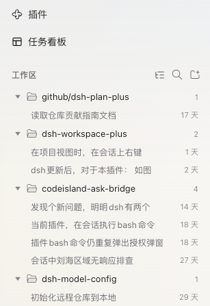
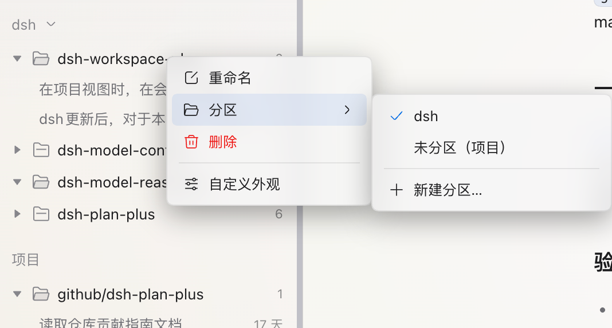
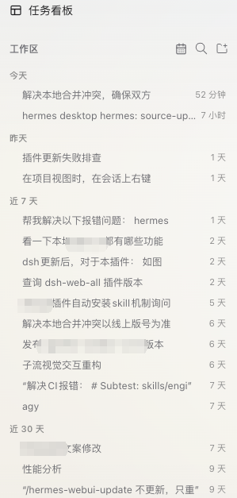
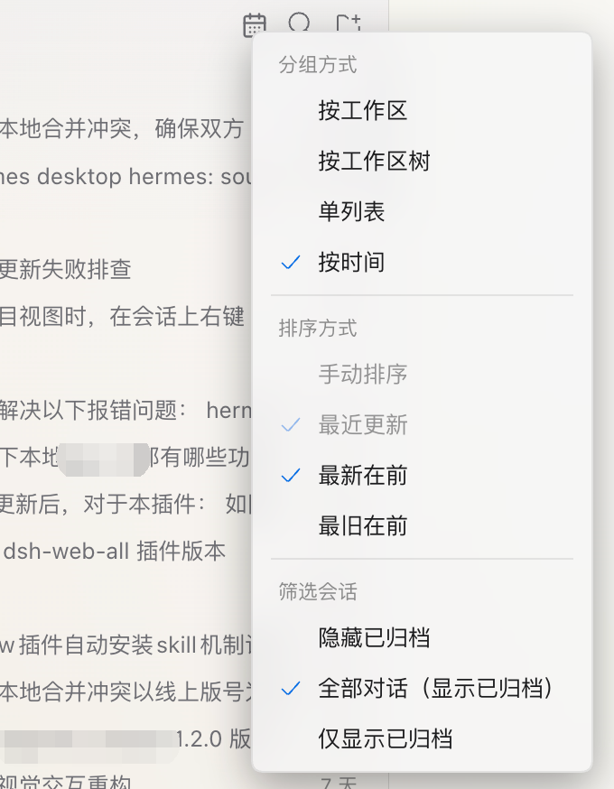
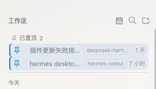
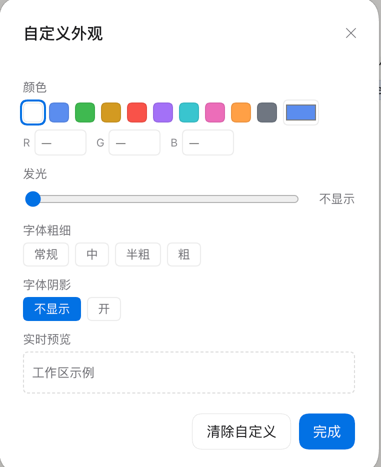
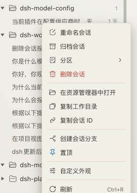

# dsh-workspace-plus

**English** | [简体中文](./README.md)

[](https://awesome-dsh-plugin.com)

> Fork of [KannaKuron/dsh-better-workspace](https://github.com/KannaKuron/dsh-better-workspace)

> A **folder system** for the DeepSeek Harness (DSH) sidebar workspace list — a workspace is still one directory, but every `/` in its name becomes hierarchy, so `web/frontend` and `web/backend` group under one virtual `web` folder.

```
github/                 <- virtual folder (naming only, not a real directory)
`- dsh-plan-plus        <- workspace "github/dsh-plan-plus"
dsh-workspace-plus      <- single-root workspaces sit at root
codeisland-ask-bridge
dsh-model-config
```

## Features & preview

### Hierarchical tree

<table>
<tr>
<td align="center" width="48%"></td>
<td valign="top"><b>Hierarchical tree (Projects view)</b><br/>Every <code>/</code> in a workspace title creates a virtual folder: <code>github/dsh-plan-plus</code> automatically groups under <code>github</code>, arbitrarily deep; workspaces without a <code>/</code> (like <code>dsh-workspace-plus</code>) stay at the root. Renaming a workspace re-derives the tree <b>instantly</b> — folders are a projection of names, there is no second source of truth.</td>
</tr>
</table>

### Add flow: pick a folder, then click a section and a group

After you pick a directory, the small dialog offers two destinations that are both **clicked out of a real list** — no typing-only native datalist:

- **Section**: the trigger opens the section list, one click selects one (including "No section (Projects)"), and "New section…" creates one inline with the workspace — cancelling the dialog never leaves an empty section behind.
- **Name-path group**: free text (e.g. `web`) with clickable suggestions for existing levels, a "New group “…”" row, and a "No nesting (root)" row.

Both controls now share one shape — a box with the chevron INSIDE its right edge — and both lists are floating panels: the dialog keeps its height while one is open, the modal card's rounded clip cannot crop them, and the bottom "name-path group" field opens upward when space is tight so the footer buttons stay visible. With a list open, Escape closes only that list; a click or ↑/↓/Home/End selects. A live preview under the fields shows the resulting title and whether the workspace joins a section. On confirm the plugin creates the workspace, writes the group prefix into its title, and places it in the chosen section. The conversation empty-state "Add workspace" menu uses the same interaction.

### Folder create/delete via context menu

Right-click any folder row: new subfolder (parent prefix pre-filled), new workspace here (the add-flow group field pre-fills with this folder), rename folder, delete empty folder — no standalone header button. Explicit empty folders persist in the browser until workspaces live inside them.

### Search

The sidebar search button filters **workspaces, independent groups and sessions** by name instantly (local title filtering); the tree force-expands while searching. Host-level content search (`session.search`) is planned.

### Workspace and session sections

<table>
<tr>
<td align="center" width="55%"></td>
<td valign="top" width="45%">
  <b>Independent Section Management</b><br/>
  Right-click a workspace or session → <b>Section</b> to choose an existing section, <b>Ungrouped (Projects)</b> or <b>New section…</b>.<br/><br/>
  A session action moves only that session; a workspace action moves the workspace and all its sessions together. Sessions can restore original placement by choosing <b>Follow workspace</b>.<br/><br/>
  Sections have one level, can be collapsed, and accept drag & drop from workspaces and sessions.
</td>
</tr>
</table>

Right-click a workspace or session → **Section**, then choose an existing section, **Ungrouped (Projects)** or **New section…**. A session action moves only that session. A workspace action moves the workspace and all its sessions, including previously sectioned sessions. Sessions can choose **Follow workspace** to restore their original placement. Creation assigns the right-clicked object; section-heading menus can create an empty section. Section creation and session forking are available through context menus, with no toolbar entries.

Sections have one level and share the same list for workspaces and sessions. Individually sectioned sessions appear directly under their section with a workspace badge. Section headings collapse. Drag a workspace or session onto a section heading to move it, or onto Projects to ungroup it. Empty and collapsed sections accept drops and expand afterward. Pinned, archived and unassigned sessions also support section moves. Recency sorting preserves local section moves without changing host order. Search disables dragging.

Workspaces and sessions have separate ID-based membership without changing names, directories or host workspace/session associations. Section-heading menus offer rename and confirmed deletion; deleting a section moves its workspaces back to Projects and individually sectioned sessions back to their workspace. Sections and collapse state persist in the current browser. Sections appear in workspace-tree and workspace views; flat and time views continue to flatten sessions. Existing title-based folders remain under Projects, while custom sections show full workspace names.

### View settings

<table>
<tr>
<td align="center" width="45%"></td>
<td valign="top" width="55%">
  <br/><br/>
  <b>One-click view switching</b><br/>
  The header button previews the active workspace, tree, list or calendar view. Its menu separates grouping, sorting and archive filters; Settings → Plugins → Configuration exposes the same choices.<br/><br/>
  <b>Time view (Global timeline)</b><br/>
  ONE global timeline across all projects — every visible session joins the same stream, bucketed by <b>today / yesterday / last 7 days / last 30 days / earlier</b> (local calendar days), empty buckets hidden; direction is <b>latest / oldest first</b>. On hover, the relative timestamp swaps for its workspace badge (and the pin button appears), with an official Tooltip popup.
</td>
</tr>
</table>

- **Workspace tree** (default): title-based folders, single-chain merging and custom appearance.
- **Workspace**: full workspace names displayed flat within independent groups and Projects. Switching views or reordering across name groups never renames a workspace.
- **Single list**: sessions across workspaces, with a workspace badge on hover. Manual order follows host workspace and session order; drag in a workspace view to adjust it.
- **Time**: global date buckets with latest-first or oldest-first ordering across buckets.
- **Sorting**: manual or recently updated, independent of grouping. Recency sorts workspaces, folders and sessions by visible session activity without changing host order; manual mode restores that order. Automatic sorting, flat and time views disable drag reordering. The pinned tray keeps pin-recency order.
- **Archive filter**: hide archived (default), all conversations, or archived only; shared by every view and search. Archived-only mode omits empty workspaces and folders, with a show-all action for empty results. Archived rows have a badge and hover/context-menu restore actions; unarchive before opening. Restore is disabled when an older host lacks the action.
- Preferences persist per browser; legacy projects/time and sorting preferences remain compatible.

### Session pinning

<table>
<tr>
<td align="center" width="45%"></td>
<td valign="top" width="55%">
  <b>Global Pinned Tray</b><br/>
  Right-click → Pin / Unpin, or click the pin button on row hover, for any session including ungrouped ones.<br/><br/>
  The <b>global Pinned section</b> stays at the very top: cross-workspace aggregation, most-recent pin first, each row tagged with its workspace name, click opens it directly (switching workspaces); a pinned session is <b>hidden inside its workspace / the ungrouped area</b> (tray-only — unpinning restores it), and a collapsed workspace row keeps a pin-count badge.<br/><br/>
  Pinned rows carry a small brand-colored pin glyph, subtle tint and a left accent bar, stacking cleanly with the current-session highlight. Pure display-layer projection (never alters titles or host order), persists across restarts, auto-unpins hard-deleted sessions, and keeps archived pins out of the tray. When archives are shown, they appear as ordinary rows; unarchiving restores their saved pin.
</td>
</tr>
</table>

### Drag & drop

Drag a workspace row above/below another to reorder (writes back the host order) or onto a folder row to move it into that group; drag session rows to reorder within the same workspace, or onto a session group to move. While dragging a workspace, merged single-chain rows temporarily re-expand into folder rows — every level of the path becomes a drop target, and chains merge back when the drag ends. Display order = host manual order, drag results are visible immediately (automatic sorting, flat/time views, archived rows and pinned rows never act as reorder surfaces).

### Status at a glance

Session rows keep the official status-light semantics: **running** (blue ring), **waiting for approval / plan review / answer** (amber), **completed** (green reminder), and **{n} subagent(s) running** (subagent count); sessions with active scheduled tasks show an alarm-clock badge (matching official rows). The **status breathing light** (toggleable in settings): status dots hidden by collapse bubble outward — workspace/folder rows breathe on their icon in the status color (custom-glow labels breathe along), session-group rows show a breathing dot; the running blue breathes only on the session row itself and never relays.

### Appearance customization

<table>
<tr>
<td align="center" width="58%"></td>
<td valign="top"><b>Appearance customization</b><br/>Right-click any row (workspace folder / workspace / session / session group) → Customize: color (9 swatches + native picker + RGB input), glow strength (0–14 slider, text glow only), font weight (regular/medium/semibold/bold), font shadow toggle, an icon grid (71 icons: 3 folder-glyph modes + 68 dsh primitives icons; icons apply to workspace &amp; workspace-folder rows only), with a live preview at the bottom. Reset returns to default in one click.</td>
</tr>
<tr>
<td align="center" width="58%"></td>
<td valign="top"><b>Applied immediately</b><br/>Color, text glow, font weight, shadow and icon apply per row and persist, together with expansion state, via the dsh client store in the current browser.</td>
</tr>
</table>

### Single-chain collapse

A toggle in the settings card (on by default): a level with exactly one child merges into one row (e.g. `level1` holding `AI trade` renders as `level1/AI trade`); with multiple children it re-expands into a tree; during workspace drags it temporarily re-expands so any level is a drop target.

### Native capabilities kept

- Session rows: open / rename / fork / archive; per-workspace new session (the + button always expands the workspace first so the new session is immediately visible); current-session highlight; ungrouped-session fallback.
- **Slash-bearing titles never nest from URLs**: when a host-generated session title lands containing `/` (e.g. echoing a pasted URL), it is auto-wrapped in `“”` and shown verbatim — only for sessions **created after this launch**, and only once the name stays stable for ~20s (letting the native AI naming land first); pre-existing sessions and your manually named `/` groupings are never touched. Quotes (manual ones too) never split on `/`, and a lone quote is just an ordinary character; unquoted URL tails still fall back flat.
- zh/en localization follows the UI language; session rows show a relative time at the tail (yields on hover).

### Context menu

<table>
<tr>
<td align="center" width="40%"></td>
<td valign="top" width="60%">
  <b>Session context menu</b><br/>
  Context menus organize operations into structured sections:
  <ul>
    <li><b>Session lifecycle</b>: Rename, archive, partition (move to section / create section / follow workspace), delete session (permanent deletion with red highlight and confirmation).</li>
    <li><b>Paths & files</b>: Open in file manager, copy working directory, copy session ID.</li>
    <li><b>Fork & persistence</b>: Fork session (opens the new branch immediately), pin (quick toggle to the pinned section).</li>
    <li><b>Custom appearance</b>: Customize appearance (per-session color, text glow, font weight, and text shadow).</li>
    <li><b>Utilities</b>: Refresh (supports <code>Ctrl+R</code> shortcut).</li>
  </ul>
</td>
</tr>
</table>

Workspace context menus offer rename, delete and customize. Folder menus offer new subfolder, new workspace here, rename group (updates all descendant workspaces), delete empty group and customize. Session groups offer rename and customize.

Directory actions prefer the target session's `cwd`, falling back to its workspace path; unassigned sessions can use their own directory. Archived sessions offer restore, delete, directory and copy actions.

Permanent deletion is implemented by this plugin's own host half (`POST /dsh-workspace-plus/delete-session`; DSH ships archive but no delete RPC), so no third-party plugin is required. After the confirmation the host stops a running task, detaches the live session, and removes only a directory that sits under `DSH_HOME/sessions` and is named exactly after the session id, then cleans the projection cache and workspace accounting. Successful deletion clears the plugin's pin entry and refreshes the session list; a refusal (missing directory, subagent session, no persistence service, out-of-root path) reports the failing step and reason.

## Install

Install the plugin into your active DSH profile. Typically `desktop` for desktop builds or `web` for web builds.

```bash
# DSH Desktop
dsh plugin --profile desktop add https://github.com/lsdt45/dsh-workspace-plus.git

# DSH Web
dsh plugin --profile web add https://github.com/lsdt45/dsh-workspace-plus.git
```

Restart DSH after installing.

### Update

Plugins installed from Git can be updated per profile:

```bash
dsh plugin --profile desktop update dsh-workspace-plus
```

If using a web profile, replace `desktop` with `web`. Restart DSH after updating.

### Local source preview

Replace the path with the absolute path to your local repository:

```bash
dsh plugin --profile desktop add /absolute/path/to/dsh-workspace-plus
```

The local folder is linked into the profile as a `link:` dependency. Edits take effect on restart. For web profiles, use `--profile web`.

### Uninstall

```bash
dsh plugin --profile desktop remove dsh-workspace-plus
```

Restart DSH after removal. For web profiles, use `--profile web`.

## How it works

The sidebar browsing region is the public `sidebar.workspaces` slot; this plugin registers the same slot with a lower priority and replaces the shipped browser with the tree. All data flows through the slot's standard snapshot hooks and injected host actions — no private APIs.

The add flow lands in the seam dsh designed for third parties: the two `directoryFlow` holes. The trigger, busy semantics, and error dialog stay official; this plugin owns everything between the trigger and the adopted path — exactly enough room for pick → section/group popup → create → prefixed rename → section placement.

Both hosts must reach the section and group data: besides passing the store directly whenever this plugin occupies `sidebar.workspaces`, each directory-flow seat now declares the same store seat (`store: viewStore`, all at root scope, so the renderer reuses one instance per handle+scope). A flow hosted by the official shell therefore still lists sections and existing groups.

View state (folder collapse, session expansion, explicit empty folders), custom styling and plugin settings persist browser-side via the dsh client store (`dsh.betterWorkspace.view.v1`). Note: that store's hydration replaces the whole value without merging defaults — after an upgrade, a stale state keeps its old shape and missing keys fall back to defaults.

## Develop

### Build

The browser half's sources live in `src/client/**` (`src/client/index.js` is the bundle entry); `src/client.js` is the
**esbuild-generated single-file artifact**. The DSH client module table accepts exactly one bundle per package
(`exports["./client"]`, flat module graph), so split sources must be bundled back into one artifact. Artifact and
sourcemap are committed, which keeps git/tarball installs build-free.

```bash
npm run build     # sources -> src/client.js (+ .map), atomic replace
npm run dev       # watch src/client/**, repackage on change (the host polls the artifact; HMR reloads the plugin)
npm run check     # fail when the committed artifact is out of sync with the sources
npm test          # node --test: pure-logic units + artifact contract + render smoke + architecture guards
npm run verify    # build + check + test
npm pack          # tarball for local install verification (prepack builds and checks first)
```

**Never edit `src/client.js` by hand** — edit `src/client/**` and run `npm run dev` (or `npm run build`).

### Stale-artifact guards

Because the artifact is committed, two guards stop a forgotten build from shipping old code:

- **Local pre-commit hook** (`.githooks/pre-commit`, versioned with the repo): runs `npm run check` on commit and
  **blocks the commit** when the artifact no longer matches `src/client/**`, printing the fix. With no installed
  dependencies (no esbuild) it warns and skips instead of blocking a fresh clone. Enable once per clone:

  ```bash
  git config core.hooksPath .githooks
  ```

  Emergency bypass: `git commit --no-verify`. Disable: `git config --unset core.hooksPath`.

- **CI** (`.github/workflows/verify.yml`, push / PR): `npm install` → `npm run check` (**before any build**, comparing
  the committed artifact) → `npm test`.

Both guards cover sync and tests only; `npm run verify` remains the full local check.

### Module map

| Path | Responsibility |
|---|---|
| `src/client/index.js` | bundle entry + the `BetterBrowser` component (probes, state, wiring); destructures each module factory's result back into the previous names |
| `src/client/platform.js` | **the only platform boundary**: `installPlatform(hostRequire)` installs react / client-store / ui-primitives; every other module imports the handles from here |
| `src/client/core/*` | pure logic (text splitting, time buckets, view rules, virtual tree + chain compression), no React/DOM, unit-tested directly |
| `src/client/browser/*` | `model`, `dnd`, `actions`, `tree-view`, `menu`, `layout` — all `createX(input)` factories whose dependencies arrive through an explicit input object |
| `src/client/{store,host,icons,styles}.js`, `ui/*`, `rows.js`, `customize.js`, `settings.js` | view store, host calls, icons, stylesheet, row components, appearance and settings |
| `src/index.js` | host half (Node): the permanent session-delete route and the settings namespace |

`tests/architecture.test.mjs` guards those boundaries (only the entry/platform layer may request platform modules;
core/i18n/styles/host may not touch platform handles; cross-module references need an import; component-scope names must
arrive through `input`). `tests/browser.render.test.mjs` really renders the sidebar with a stub React — all four views,
the archive filter, the pinned tray, sections and custom styling — so a module that lost an input fails here immediately.

### Local verification

Install the tarball into a profile, or link the repository path directly:

```bash
dsh plugin --profile web add /absolute/path/to/dsh-workspace-plus   # linked directory: source edits apply after a restart
```

Checklist: hierarchy tree, add-workspace dialog, rename with instant re-sort, new group, time buckets, pinned tray,
drag reordering, context menus, appearance customisation, settings toggles, the permanent session delete round-trip, and
the fallback to the shipped browser after uninstall.

> Note: a profile that installed this plugin as a **copy** (rather than a `link:`) keeps serving that copy — only a
> `link:` install picks up freshly built artifacts.

## License

[MIT](./LICENSE)
